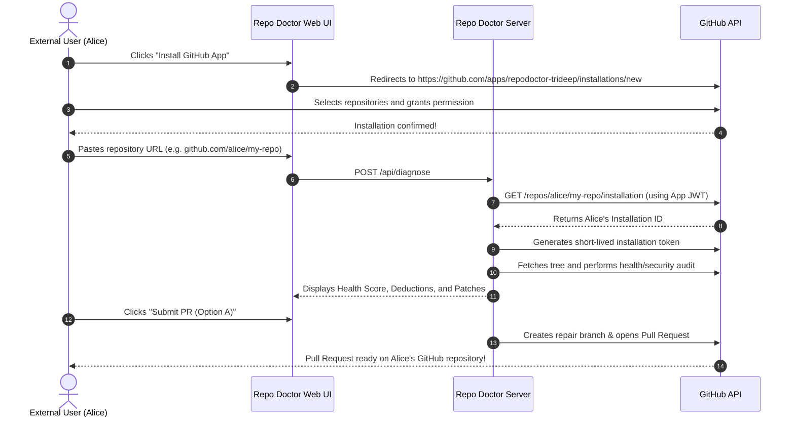

# 🚀 Repo Doctor — Production Deployment & Multi-User GitHub App Guide

This guide explains how to deploy **Repo Doctor** to the cloud (e.g. **Vercel**, **Railway**, or **Render**) so you can share your public URL with **anyone**, and allow them to diagnose and open automated repair Pull Requests on their own repositories.

---

## 🧠 Core Architecture: What Happens to Your Credentials?

When switching from local development to a public, multi-user deployment, here is exactly what happens to each credential:

| Credential | In Local `.env` | In Production Deployment | Explanation & Action Required |
| :--- | :--- | :--- | :--- |
| **`GITHUB_APP_ID`** | `5406515` | **STAYS THE SAME (`5406515`)** | The numeric ID identifies your registered GitHub App. Every user interacts through this single App. Add `GITHUB_APP_ID` to your cloud environment variables. |
| **`GITHUB_APP_PRIVATE_KEY`** | Local path via `.pem` file (`GITHUB_APP_PRIVATE_KEY_PATH`) | **STAYS THE SAME KEY, BUT STORED AS AN ENV VARIABLE** | Cloud servers do not have access to your local Mac directory (`/Users/trideep/...`). In Vercel or cloud settings, set `GITHUB_APP_PRIVATE_KEY` by pasting the full PEM text or its Base64 string. |
| **`GITHUB_APP_INSTALLATION_ID`** | Your personal ID (`173638247`) | **DO NOT SET IN PRODUCTION! (LEAVE EMPTY)** | `173638247` is **only** for your personal GitHub account. **Every user who installs your app gets their own unique Installation ID**. Repo Doctor dynamically discovers each user's Installation ID on-the-fly via GitHub's API (`GET /repos/:owner/:repo/installation`). |

---

## 🛠️ Step 1: Configure Your GitHub Developer App for Public Multi-User Access

Before other users can use your deployed app, your GitHub App must be set to allow external installations:

1. Go to [GitHub Developer Settings → GitHub Apps](https://github.com/settings/apps).
2. Click on your app: **`RepoDoctor-Trideep`** (App ID: `5406515`).
3. **Make App Public ("Any account")**:
   - In the left sidebar, click **Advanced**.
   - Under **"Where can this GitHub App be installed?"**, change from:
     - ❌ *"Only on this account"*
     - to:
     - ✅ **"Any account"**
   - Click **Save changes**.
4. **Update URLs** (in **General** settings tab):
   - **Homepage URL**: Set to your production URL (e.g., `https://repo-doctor.vercel.app`).
   - **Callback URL**: Set to `https://repo-doctor.vercel.app/` (or leave empty if not using OAuth login).
   - **Webhooks**: You can uncheck "Active" under Webhook if you are not processing incoming webhooks, or keep it configured.
5. **Verify Permissions** (under **Permissions & events → Repository permissions**):
   - **Contents**: `Read and write` (required to inspect code and commit fixes)
   - **Pull requests**: `Read and write` (required to open repair PRs)
   - **Workflows**: `Read and write` (required if fixing CI/CD GitHub Action workflows)
   - **Metadata**: `Read-only` (default)
   *(If you change permissions, GitHub will prompt existing installations to accept updated permissions).*

---

## ☁️ Step 2: Deploy to Vercel (Recommended)

Repo Doctor is pre-configured with `vercel.json` for serverless API endpoints and static client bundling.

### Option A: Via GitHub & Vercel Dashboard (Easiest)
1. Push your repository to GitHub.
2. Go to [vercel.com](https://vercel.com) and click **"Add New..." → "Project"**.
3. Import your **Repo Doctor** repository.
4. Keep the default settings:
   - **Framework Preset**: Vite
   - **Build Command**: `npm run build`
   - **Output Directory**: `client/dist`
5. In **Environment Variables**, add the following:

| Variable Name | Value | Notes |
| :--- | :--- | :--- |
| `GITHUB_APP_ID` | `5406515` | Your GitHub App ID |
| `GITHUB_APP_PRIVATE_KEY` | Paste the entire PEM key | See note below on formatting |
| `AI_PROVIDER` | `deterministic` | Or `gemini` / `openai` |
| `GEMINI_API_KEY` | *(Optional)* | Only if using Gemini |
| `OPENAI_API_KEY` | *(Optional)* | Only if using OpenAI |

> 💡 **Formatting Private Key for Vercel**:
> You can paste the raw multi-line PEM key directly into Vercel's value input.
> Alternatively, base64 encode it in your terminal:
> ```bash
> base64 -i /Users/trideep/Documents/important/repodoctor-trideep.2026-10-20.private-key.pem | tr -d '\n'
> ```
> Paste that single-line base64 string into `GITHUB_APP_PRIVATE_KEY`. Repo Doctor automatically detects and decodes base64 keys!

6. Click **Deploy**.

---

## 👥 Step 3: How External Users Use Your Deployed App

Once deployed, anyone you send the link to (`https://your-app.vercel.app`) can use it effortlessly:



### User Journey:
1. **One-Click Installation**:
   - The user opens your link.
   - They click the **"Install GitHub App"** button (in the top Navbar or on the homepage banner).
   - GitHub asks: *"Where do you want to install RepoDoctor-Trideep?"*
   - They pick their personal account (or organization) and choose either **"All repositories"** or **"Only select repositories"**.
2. **Diagnosis & Repair**:
   - The user pastes their repository URL into the search box and clicks **Diagnose**.
   - They review the transparent 0–100 score, security findings, and synthesized fixes in the Repair Workspace.
   - They click **"Submit PR (Option A)"**.
   - A dedicated branch (`repo-doctor/health-fixes-...`) is created, fixes are committed, and a Pull Request is opened directly on their repository!
